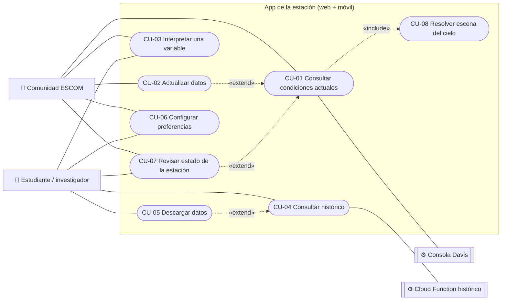

# 02 · Casos de uso

Mermaid no tiene diagrama UML de casos de uso. Se usa un `flowchart` con esta convención: los actores son nodos
rectangulares fuera del sistema, los casos de uso son óvalos dentro del recuadro y `«include»`/`«extend»` van
como etiquetas en las flechas.

## Diagrama

El investigador también puede hacer todo lo que hace la comunidad (CU-01 y CU-02). Esa herencia no se dibuja
para no saturar el diagrama.

## Especificaciones

### CU-01 Consultar condiciones actuales
- **Actor:** Comunidad ESCOM (y cualquier actor).
- **Cubre:** RF-APP-01, 03–12, 28, 29.
- **Precondición:** ninguna; no hay login.
- **Flujo principal:**
  1. El usuario abre la app.
  2. Se muestra la pantalla de carga.
  3. El sistema consulta el dato en vivo: en web a través del proxy, en móvil directo o por el proxy.
  4. El sistema lo convierte a las unidades elegidas y resuelve la escena del cielo (CU-08).
  5. Se muestran las tarjetas.
  6. Cada 60 s el sistema repite desde el paso 3 sin bloquear la UI.
- **Flujos alternos:**
  - **A1. Sin conexión en la primera carga.** Se muestra la escena "Sin conexión" con un botón para reintentar.
  - **A2. Falla una consulta posterior.** Se conserva la última lectura y se muestra el aviso "sin conexión"
    junto con la hora del dato.
  - **A3. Dato de más de 2 min.** Aviso "dato desactualizado".
  - **A4. Campo `---`.** La tarjeta muestra "sin dato" y las demás siguen normales.
- **Postcondición:** el usuario ve un dato de menos de 2 min, o sabe que no está disponible.

### CU-02 Actualizar datos
- **Actor:** Comunidad ESCOM.
- **Cubre:** RF-APP-02.
- **Flujo:**
  1. El usuario pulsa "Actualizar".
  2. El botón pasa a "Actualizando…" y queda deshabilitado.
  3. Se hace una consulta (CU-01, paso 3).
  4. El contador de antigüedad vuelve a 0.
- **Alterno:** si falla, se aplica A2 de CU-01.

### CU-03 Interpretar una variable
- **Actores:** Comunidad ESCOM, Estudiante/investigador.
- **Cubre:** RF-APP-08, 27; RNF-APP-06.
- **Flujo:**
  1. El usuario abre la ayuda de una tarjeta.
  2. El sistema muestra qué es la variable, cómo leerla y qué indica el valor actual. Por ejemplo: "punto de
     rocío a 1 °C de la temperatura: probable neblina".

### CU-04 Consultar histórico
- **Actor:** Estudiante / investigador.
- **Cubre:** RF-APP-13–19, 21; RNF-APP-01, 06.
- **Flujo principal:**
  1. El usuario abre "Histórico".
  2. El sistema propone los últimos 7 días con resolución por hora.
  3. El usuario cambia el periodo o la resolución (opcional).
  4. El sistema parte el rango en consultas de 10 días o menos, las une, las ordena y las remuestrea.
  5. El sistema calcula los KPIs y dibuja las gráficas por variable.
- **Flujos alternos:**
  - **A1. Rango sin datos** (por ejemplo, un día perdido, como el 2026-09-07). El sistema muestra "sin datos en
    este periodo" y no dibuja gráficas vacías.
  - **A2. El rango incluye hoy o ayer.** El sistema avisa que el histórico llega con un día de retraso.
  - **A3. Falla la API.** El sistema muestra un error con opción de reintentar y conserva la consulta anterior.
- **Postcondición:** las gráficas y los KPIs corresponden exactamente al periodo elegido.

### CU-05 Descargar datos
- **Actor:** Estudiante / investigador.
- **Cubre:** RF-APP-20.
- **Precondición:** hay una consulta de histórico con datos.
- **Flujo:**
  1. El usuario elige CSV o JSON.
  2. El sistema genera el archivo con las filas del periodo, con la unidad en el nombre de la columna.
  3. El navegador lo descarga, o en móvil se abre el menú de compartir.

### CU-06 Configurar preferencias
- **Actores:** todos.
- **Cubre:** RF-APP-22–26.
- **Flujo:**
  1. El usuario abre ajustes.
  2. Cambia el tema, el idioma, las unidades o el tamaño de texto.
  3. La UI se actualiza al instante.
  4. La preferencia se guarda en el dispositivo.

### CU-07 Revisar estado de la estación
- **Actores:** Comunidad ESCOM, Estudiante/investigador.
- **Para qué:** saber si se puede confiar en el dato. Por ejemplo, con batería baja o mala señal las lecturas
  pueden atrasarse o faltar.
- **Cubre:** RF-APP-12.
- **Flujo:**
  1. En "Ahora", el pie de la pantalla muestra la batería, la señal y el tiempo encendida.
  2. Si la batería o la señal están por debajo de un umbral, el valor se resalta.
- **Nota:** no se muestran datos de red internos.

### CU-08 Resolver escena del cielo
- **Actor:** el sistema, incluido en CU-01.
- **Cubre:** RF-APP-03.
- **Flujo:** se aplican, en orden, las capas de la regla `skyMap` ([06 · Datos](06-datos.md#escena-del-cielo)).

