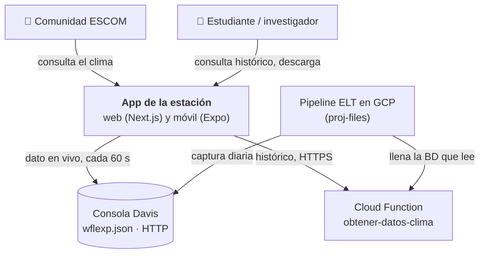
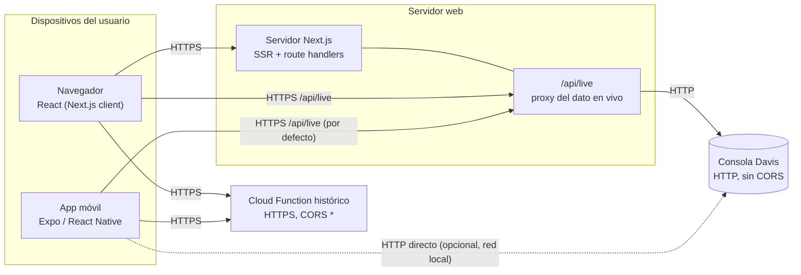
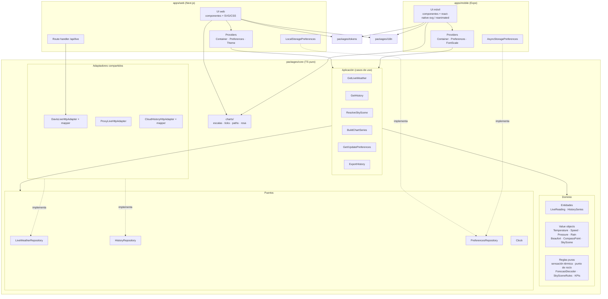

# 03 · Arquitectura

Se sigue el modelo C4 de forma ligera: contexto → contenedores → componentes. La regla central es la
**arquitectura hexagonal**: el dominio no conoce React, HTTP ni almacenamiento, y todo eso entra por puertos.

## Nivel 1 · Contexto

La app **solo lee**. El pipeline ELT (fuera de este repo) es el único que escribe en la base de datos.

## Nivel 2 · Contenedores

- **Por qué hay proxy.** La consola solo habla HTTP y no manda cabeceras CORS. Un navegador servido por HTTPS no
  puede llamarla. El proxy además oculta la IP de la consola y le baja la carga con caché de unos segundos
  ([ADR-0007](adr/0007-proxy-dato-en-vivo.md)).
- **El histórico va directo a la Cloud Function.** Ya tiene CORS abierto, así que no hay que pasarlo por el
  servidor.
- **El móvil usa el proxy por defecto.** Así evita configurar excepciones de *cleartext* en Android e iOS y
  funciona fuera de la red del IPN. La conexión directa queda como opción por variable de entorno.

## Nivel 3 · Componentes (hexagonal)

### Regla de dependencias

| Desde \ hacia | dominio | aplicación | puertos | adaptadores | React / plataforma |
|---|---|---|---|---|---|
| **dominio** | ✓ | ✗ | ✗ | ✗ | ✗ |
| **aplicación** | ✓ | ✓ | ✓ | ✗ | ✗ |
| **adaptadores** (`core`) | ✓ | ✗ | ✓ | ✓ | ✗ (solo `fetch` estándar) |
| **apps** | ✓ | ✓ | ✓ | ✓ | ✓ |

Una regla de lint (`no-restricted-imports`) lo hace cumplir en `packages/core`: no se permite importar `react`,
`react-native`, `next/*` ni `expo*`.

### Composición (DI)

Cada app arma sus dependencias en un **composition root**:
`createContainer({ liveUrl, historyUrl, preferencesRepository, clock })` devuelve los casos de uso ya conectados.
Un provider de React los reparte. En los tests se llama a `createContainer` con dobles (repositorios en memoria,
reloj fijo) en lugar de los adaptadores reales.

## Despliegue

La arquitectura no depende de dónde se publique cada app. El servidor web solo necesita un runtime de Node que
pueda hacer HTTP saliente. El hosting y la entrega actuales se describen en el anexo operativo
[09 · Despliegue](09-despliegue.md).
