# 04 · Modelo de dominio

Este modelo une los dos `WeatherEntity` que existen hoy: `apps/mobile/src/core/domain/models/WeatherEntity.ts` y
`apps/web/lib/domain/weather.entity.ts`. Corrige sus errores y separa el dato en vivo del histórico.

## Decisiones del modelo

- **Unidad canónica interna: métrico SI de la app** (°C, km/h, mm, hPa). Los mappers convierten al entrar. La UI
  convierte a imperial solo para mostrar. Así el histórico (ya métrico) y el dato en vivo (imperial) se comparan
  sin conversiones dispersas.
- **Presión.** La consola entrega inHg y el histórico mmHg. Se guarda en hPa. La UI ofrece hPa y mmHg en métrico,
  e inHg en imperial.
- **"Sin dato" es `null`, nunca 0.** Los mappers traducen `---`, `""` y `null` a `null`.
- **Las fechas son instantes** (`Date`) creados en America/Mexico_City desde `fecha` + `hora` o desde `loctime`.

## Diagrama de clases

```mermaid
classDiagram
  direction LR

  class LiveReading {
    +observedAt: Date
    +station: StationStatus
    +outdoor: OutdoorConditions
    +indoor: IndoorConditions
    +wind: WindConditions
    +pressure: PressureConditions
    +rain: RainTotals
    +sun: SunTimes
    +forecast: ForecastRule
    +extremes: DailyMonthlyExtremes
  }
  class StationStatus {
    +name: string
    +batteryVolts: number|null
    +signalDbm: number|null
    +uptimeSeconds: number|null
  }
  class OutdoorConditions {
    +temperatureC: number|null
    +humidityPct: number|null
    +dewPointC: number|null
    +feelsLikeC: number|null
    +feelsLikeReason: FeelsLikeReason
  }
  class WindConditions {
    +speedKmh: number|null
    +avg2Kmh: number|null
    +avg10Kmh: number|null
    +gustKmh: number|null
    +directionDeg: number|null
    +gustDirectionDeg: number|null
    +beaufort() Beaufort
    +compassPoint() CompassPoint
  }
  class PressureConditions {
    +hPa: number|null
    +trend: PressureTrend
  }
  class RainTotals {
    +rateMmH: number|null
    +last15mMm: number|null
    +lastHourMm: number|null
    +todayMm: number|null
    +last24hMm: number|null
    +stormMm: number|null
    +monthMm: number|null
    +yearMm: number|null
  }
  class SunTimes {
    +sunrise: LocalTime
    +sunset: LocalTime
    +solarNoon() LocalTime
    +progressAt(t: Date) number
  }
  class ForecastRule {
    +code: number
    +decode() ForecastParts
  }
  class ForecastParts {
    +sky: Sky
    +temperature: TempChange
    +precipitation: PrecipOutlook
    +wind: WindOutlook
  }
  class DailyMonthlyExtremes {
    +temperature: Range4
    +humidity: Range4
    +pressure: Range4
  }

  LiveReading *-- StationStatus
  LiveReading *-- OutdoorConditions
  LiveReading *-- WindConditions
  LiveReading *-- PressureConditions
  LiveReading *-- RainTotals
  LiveReading *-- SunTimes
  LiveReading *-- ForecastRule
  LiveReading *-- DailyMonthlyExtremes
  ForecastRule ..> ForecastParts

  class HistorySample {
    +at: Date
    +temperatureC: number|null
    +temperatureMaxC: number|null
    +temperatureMinC: number|null
    +indoorTemperatureC: number|null
    +humidityPct: number|null
    +indoorHumidityPct: number|null
    +windKmh: number|null
    +gustKmh: number|null
    +windDirection: CompassPoint|null
    +rainMm: number|null
    +rainRateMmH: number|null
    +pressureHPa: number|null
  }
  class HistorySeries {
    +range: DateRange
    +samples: HistorySample[]
    +resample(r: Resolution) HistorySeries
    +cumulativeRain() number[]
  }
  class HistorySummary {
    +temperature: TempKpis
    +wind: WindKpis
    +rain: RainKpis
    +pressure: PressureKpis
  }
  HistorySeries o-- HistorySample
  HistorySeries ..> HistorySummary : summarize()

  class SkyScene {
    <<enumeration>>
    clearDay
    clearNight
    dawn
    twilight
    partly
    increasing
    cloudy
    nightCloudy
    clearing
    drizzle
    rain
    nightRain
    storm
    likely
    windy
    windShift
    warmer
    cooler
    fog
    calibrating
    offline
  }

  class UserPreferences {
    +theme: system|light|dark
    +language: es|en
    +units: metric|imperial
    +textSize: s|m|l
  }

  class LiveWeatherRepository {
    <<interface>>
    +getCurrent() Promise~LiveReading~
  }
  class HistoryRepository {
    <<interface>>
    +getSamples(range: DateRange) Promise~HistorySample[]~
  }
  class PreferencesRepository {
    <<interface>>
    +load() Promise~UserPreferences~
    +save(p: UserPreferences) Promise~void~
  }
  class Clock {
    <<interface>>
    +now() Date
  }
```

## Casos de uso (aplicación)

| Caso de uso | Firma | Depende de | RF |
|-------------|-------|------------|----|
| `GetLiveWeather` | `() → Promise<LiveReading>` | `LiveWeatherRepository` | RF-APP-01, 02 |
| `ResolveSkyScene` | `(reading: LiveReading \| null, now: Date) → SkyScene` | reglas de dominio | RF-APP-03 |
| `GetHistory` | `(range: DateRange) → Promise<HistorySeries>`: parte en tramos de 10 días o menos, une, quita duplicados y ordena | `HistoryRepository` | RF-APP-06 |
| `BuildChartSeries` | `(series, resolution, units) → ChartSeries` | dominio + `charts/` | RF-APP-07 |
| `SummarizeHistory` | `(series) → HistorySummary` | dominio | RF-APP-08 |
| `ExportHistory` | `(series, format: csv\|json, units) → Blob-like string` | dominio | RF-APP-09 |
| `GetPreferences` / `UpdatePreferences` | `() → Promise<UserPreferences>` / `(patch) → Promise<UserPreferences>` | `PreferencesRepository` | RF-APP-10 |

## Reglas de dominio (funciones puras)

| Regla | Definición | Fuente |
|-------|------------|--------|
| Sensación térmica | `heat ?? chill ?? temperatura`. El motivo es "calor y humedad", "viento" o "igual que la temperatura" | `realtime-data-schema.md` |
| Punto de rocío | Lo da la consola (`dew`). Se recalcula con Magnus solo si falta | Meteorología estándar |
| Beaufort | Tabla oficial en km/h (0: < 1, 1: 1–5, …, 12: ≥ 118) | OMM |
| Rosa de 16 rumbos | `round(deg / 22.5) mod 16` | Convención |
| Mediodía solar | Punto medio entre amanecer y ocaso | Diseño (`sun.noon`) |
| Escena del cielo | Tabla de decisión en [06 · Datos](06-datos.md#escena-del-cielo) | Nota `skyMap` del canvas |
| Pronóstico | `ForecastDecoder` (195 reglas) → `ForecastParts` → frase por idioma | `apps/mobile/src/core/domain/utils/ForecastDecoder.ts` |
