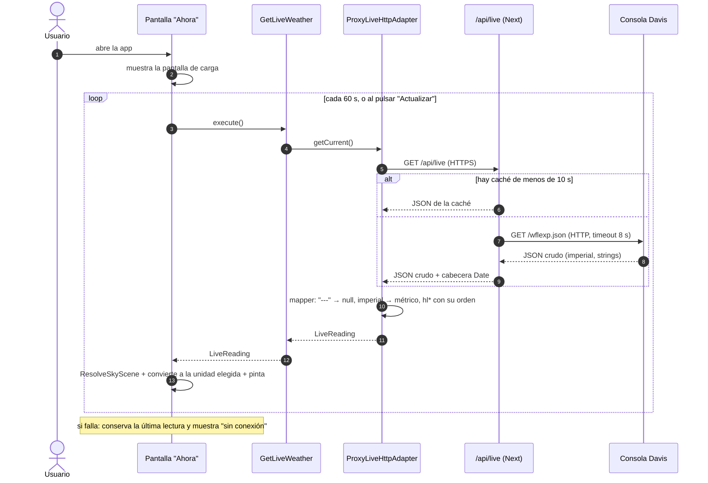
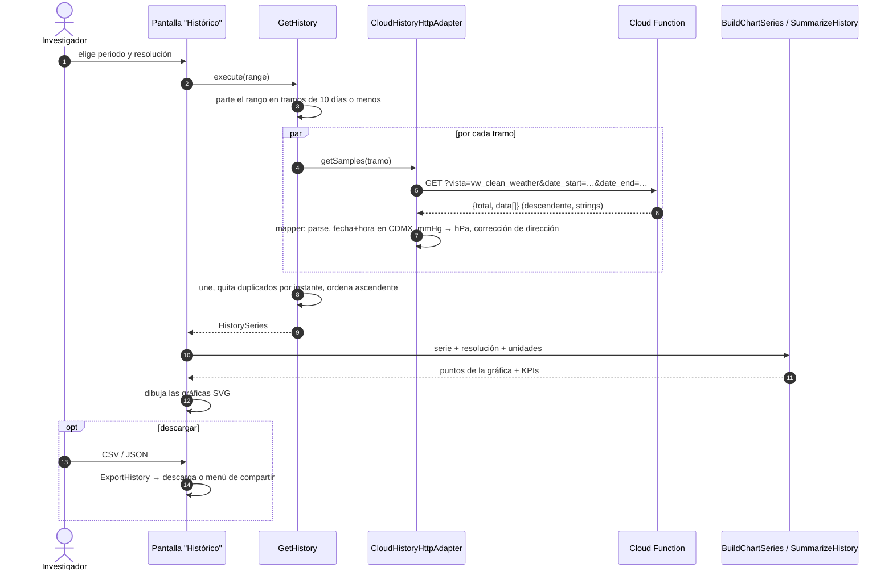
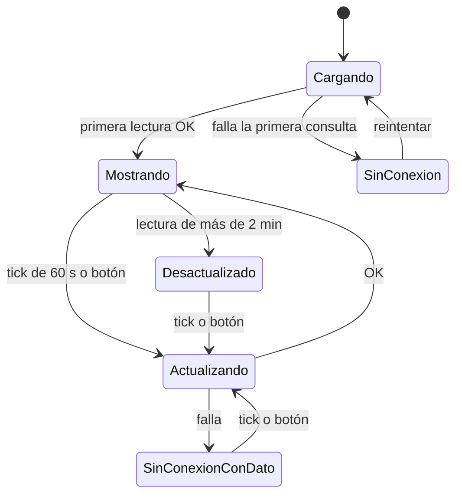
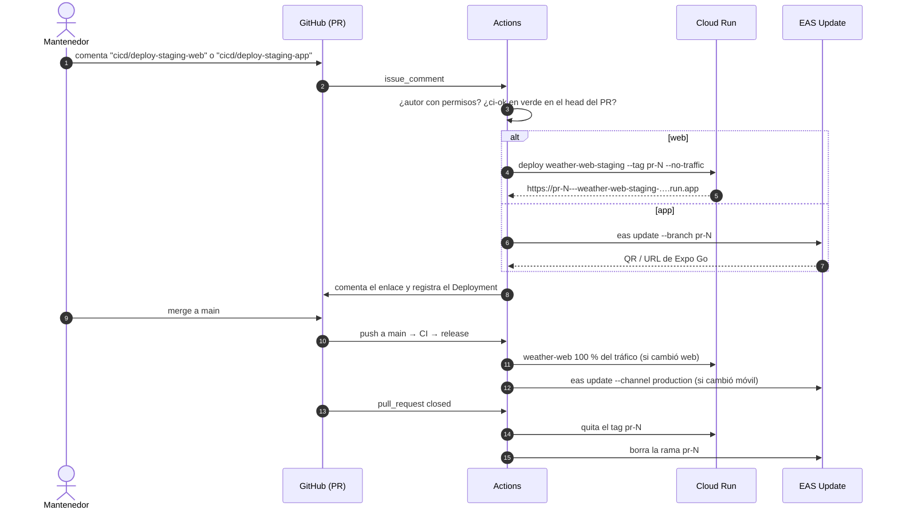

# 05 · Flujos

## Dato en vivo (CU-01, CU-02)



## Histórico (CU-04, CU-05)



## Cambio de preferencias (CU-06)

```mermaid
sequenceDiagram
  actor U as Usuario
  participant S as Panel de ajustes
  participant PP as PreferencesProvider
  participant UP as UpdatePreferences
  participant PR as PreferencesRepository<br/>(localStorage | AsyncStorage)

  U->>S: cambia el tema / idioma / unidades / tamaño
  S->>PP: update({ theme: "dark" })
  PP->>UP: execute(patch)
  UP->>UP: valida y combina con los valores por defecto
  UP->>PR: save(prefs)
  UP-->>PP: prefs
  PP->>PP: aplica: web → class en <html> / --font-scale / lang; móvil → Appearance + FontScaleContext
```

## Estados de la pantalla "Ahora"



## Staging por comentario y release (CU-09, CU-10)


