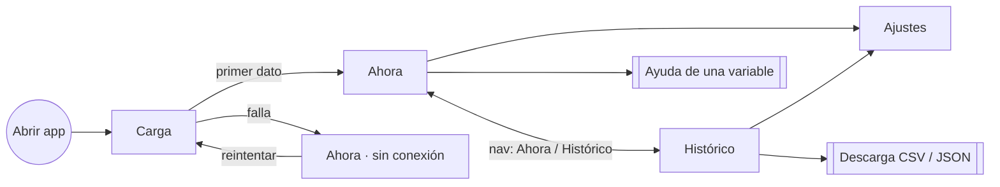

# 07 · Interfaz

El diseño de referencia es el canvas de Claude Design "Estación meteorológica"
(<https://claude.ai/artifact/20bb9e0e-2d1d-4854-89ee-aefb52c44c34>). Cada pantalla tiene un artboard en tema
oscuro y otro en tema claro. Los datos que muestran los artboards son simulados.

## Pantallas

| Pantalla | Web | Móvil | Casos de uso |
|----------|-----|-------|--------------|
| Carga | `LoadingWeb`, `LoadingWebClaro` | `LoadingMobile`, `LoadingMobileClaro` | CU-01 |
| Ahora | `Dashboard`, `DashboardClaro` | `MobileNow`, `MobileNowClaro` | CU-01, 02, 03, 07 |
| Histórico | `Main`, `MainClaro` (componente `WeatherHistory`) | `MobileHistory`, `MobileHistoryClaro` | CU-04, 05 |
| Ajustes | Controles en la cabecera | Hoja modal `m.settings` | CU-06 |
| Escena del cielo | 21 artboards `Sky*` (640×220) | Los mismos, adaptados | CU-08 |

## Navegación

- **Web:** cabecera fija con el nombre de la estación, el estado "en vivo", la navegación, el botón de
  actualizar, unidades, idioma, tema y tamaño de texto.
- **Móvil:** barra inferior (Ahora / Histórico) y un botón de ajustes que abre una hoja con los mismos controles.
- **En el histórico móvil**, las secciones (temperatura, viento, lluvia, presión) son acordeones, con un control
  para abrir o cerrar todas.

## Contenido de "Ahora"

Va en el mismo orden en las dos plataformas. La web lo acomoda en una cuadrícula y el móvil en una columna.

1. **Hero.**
   - Escena del cielo con su etiqueta.
   - Temperatura exterior.
   - Sensación térmica y su motivo.
   - Rango del día/mes.
   - Humedad, viento, lluvia de hoy y presión.
2. **Pronóstico** de la consola.
3. **Sol:** amanecer, mediodía y ocaso.
4. **Viento:** compás, Beaufort y velocidades.
5. **Presión:** valor, tendencia y variación del día.
6. **Humedad:** rango y punto de rocío.
7. **Interior:** temperatura, humedad y confort.
8. **Lluvia:** intensidad y acumulados.
9. **Estado de la estación:** batería, señal y tiempo encendida.

## Contenido de "Histórico"

- **Controles:** periodo (atajos y "últimos N días" o rango personalizado), resolución, la opción de mostrar el
  interior y la descarga.
- **Secciones**, cada una con KPIs y gráficas:
  - Temperatura: media con banda y humedad.
  - Viento: velocidad y ráfaga, más la rosa de los vientos.
  - Lluvia: barras por intervalo y acumulado.
  - Presión: valor, banda y tendencia.
- En web se puede elegir qué variables se muestran.

## Preferencias

| Preferencia | Valores | Por defecto | Clave en almacenamiento | Efecto |
|-------------|---------|-------------|-------------------------|--------|
| Tema | sistema / claro / oscuro | sistema | `wx-theme` | Web: clase en `<html>` y variables CSS ([ADR-0002](adr/0002-next-y-expo.md)). Móvil: `Appearance.setColorScheme` |
| Idioma | es / en | es | `wx-lang` | Catálogo de `packages/i18n`. Web: además `<html lang>` |
| Unidades | métrico / imperial | métrico | `wx-units` | Conversión al mostrar |
| Tamaño de texto | s / m / l | m | `wx-size` | Web: `--font-scale`. Móvil: `FontScaleContext`, multiplicado por el `fontScale` del sistema |

## Sistema visual

- **Tipografía:** IBM Plex Sans para el texto y IBM Plex Mono para cifras y unidades.
- **Tokens** en `packages/tokens`: paleta clara y oscura (Catppuccin Latte y Mocha) tomada de los artboards.
  En tema claro el texto de color usa variantes `*-text` más oscuras, para alcanzar 4.5:1.
- **Escenas del cielo** en `packages/sky-art`, extraídas de los artboards `Sky*` con un script ([ADR-0009](adr/0009-arte-del-diseno-por-extraccion.md)).
- **Iconos:** de trazo, sin emoji.
- **Gráficas:** SVG propio, con geometría compartida desde `packages/core/charts`
  ([ADR-0006](adr/0006-graficas-svg-propias.md)).
- **Movimiento:** las escenas y las transiciones se apagan con `prefers-reduced-motion` o con la opción
  equivalente del sistema.

## Accesibilidad (RNF-APP-05)

- Contraste ≥ 4.5:1 en texto, también en las etiquetas grises de 11 px. Hay que revisarlo en **los dos** temas.
- Botones y enlaces reales: `<button>`/`<a>` en web, `Pressable` con `accessibilityRole` en móvil.
  `aria-label` en los botones que solo tienen ícono.
- Cada gráfica tiene un resumen textual (`role="img"` + `aria-label`, o `accessibilityLabel`), con el rango y los
  extremos.
- Los colores que deben distinguirse también difieren en luminosidad, no solo en tono. Se prefiere azul/naranja a
  rojo/verde.
- Objetivos táctiles ≥ 44 px.
