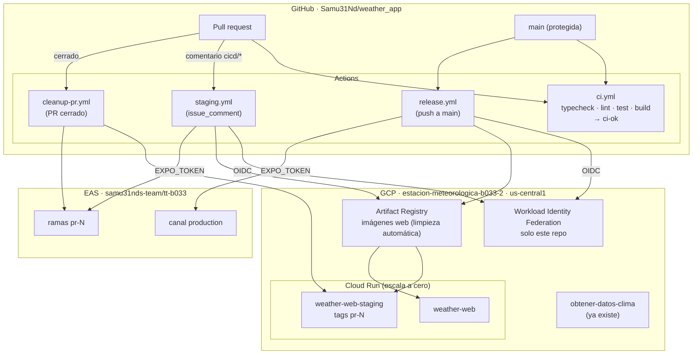

# 09 · Despliegue (anexo operativo)

Este anexo es para el equipo que opera el sistema. Explica cómo se construye, publica y revierte cada app.
No forma parte de la especificación funcional: la app no depende de él, y cambiar de hosting no cambia nada de los
documentos 00–08.

GitHub Actions orquesta todos los despliegues. Cloud Run (web) y EAS Update (móvil) solo son los lugares donde
queda publicada cada app.

## Entornos

| Entorno | Web | Móvil | Cuándo se crea | Cuándo se borra |
|---------|-----|-------|----------------|-----------------|
| Local | `npm run web` | `npm run mobile` (Expo Go) | — | — |
| Staging de un PR | Revisión de `weather-web-staging` con el tag `pr-N`, sin tráfico. URL `https://pr-N---weather-web-staging-….run.app` | EAS Update en la rama `pr-N` (QR para Expo Go) | Al comentar `cicd/deploy-staging-web` o `cicd/deploy-staging-app` en el PR | Al cerrar o mergear el PR |
| Producción | `weather-web` con el 100 % del tráfico | EAS Update en el canal `production` | Al hacer merge a `main`, si cambió esa app | — |

El **APK de producción** se genera a mano al final ([ADR-0005](adr/0005-movil-ota-apk-al-final.md)).

## Diagrama de despliegue



## Reglas del flujo

- `main` exige el check `ci-ok` y **no permite saltarse la protección**, ni siquiera a los administradores. Se
  mergea con squash y la rama se borra al mergear.
- `ci-ok` resume todos los jobs. Así, los jobs que no corren porque su ruta no cambió no bloquean el merge.
- `staging.yml` vive en `main`, así que un PR no puede modificarlo para darse permisos. Solo actúa si:
  - quien comenta es OWNER, MEMBER o COLLABORATOR;
  - el comentario es exactamente `cicd/deploy-staging-web` o `cicd/deploy-staging-app`;
  - `ci-ok` del commit del PR está en verde.
- Producción **solo se publica desde `main`** y solo para la app que cambió (filtro de rutas: `apps/web/**`,
  `apps/mobile/**` y `packages/**`, que afecta a las dos).
- Los releases se marcan con `web-vAAAA.MM.DD[.n]` y `mobile-vAAAA.MM.DD[.n]`.
- **QR de producción móvil:** el release `mobile-v…` y el resumen del job de `release.yml` traen el QR de la
  actualización para abrirla en Expo Go. La app instalada (APK) no lo necesita: recibe sola las actualizaciones del
  canal `production`.
- Los workflows que se disparan por comentario corren con la versión de `main`. Si un PR agrega una variable al
  despliegue (como `EXPO_PUBLIC_HISTORY_API_URL`), su staging no la recibe hasta que se mergea.

## Infraestructura

- La infraestructura de GCP (servicios Cloud Run, Artifact Registry, cuenta de servicio y WIF) se define como
  **Terraform en `proj-files/infra`**, junto al resto del sistema. No va en este repo.
- **Cuenta de servicio de despliegue:** permisos mínimos: `run.developer` sobre los dos servicios,
  `artifactregistry.writer` sobre el repositorio de imágenes e `iam.serviceAccountUser` sobre la cuenta de
  ejecución.
- **Los servicios web corren con una cuenta de servicio propia sin permisos de GCP.** Solo hacen HTTP saliente.

## Configuración

| Nombre | Tipo | Uso |
|--------|------|-----|
| `EXPO_TOKEN` | secreto | Token del robot user de EAS (rol Developer) |
| `GCP_WIF_PROVIDER` | variable | Proveedor OIDC (`terraform output web_wif_provider`) |
| `GCP_DEPLOY_SA` | variable | Cuenta de servicio que despliega (`web_deployer_sa`) |
| `GCP_RUNTIME_SA` | variable | Cuenta de servicio con la que corre la web (`web_runtime_sa`) |
| `WEB_REGISTRY` | variable | Repositorio de imágenes (`web_registry`) |
| `NEXT_PUBLIC_API_URL` | variable | URL base de la consola. Se pasa al build y la usa el proxy `/api/live` del servidor |
| `NEXT_PUBLIC_API_CLOUD_URL` | variable | URL de la Cloud Function de histórico, para la web y (como `EXPO_PUBLIC_HISTORY_API_URL`) para el móvil |
| `MOBILE_WEATHER_STATION_URL` | variable | URL del dato en vivo para la app móvil: el proxy `https://weather-web-…run.app/api/live` (ADR-0007) |

Los archivos son:
- `.github/workflows/{ci,staging,cleanup-pr,release}.yml`;
- `.github/actions/release-tag`;
- `apps/web/Dockerfile`, una imagen *standalone* de Next construida desde la raíz;
- `apps/mobile/eas.json`;
- `proj-files/infra/web_hosting.tf`.

## Costos estimados (RNF-APP-11)

| Recurso | Uso esperado | Capa gratuita | Costo esperado |
|---------|--------------|---------------|----------------|
| Cloud Run (2 servicios, mínimo 0 instancias) | Tráfico de la comunidad ESCOM | 2 M solicitudes y 180 k vCPU-s al mes | ≈ 0 USD |
| Artifact Registry | ≤ 10 imágenes de unos 150 MB | 0.5 GB | ≈ 0–0.1 USD |
| GitHub Actions | Repo público | Ilimitado en repos públicos | 0 USD |
| EAS Update | Pocos usuarios activos | Plan gratuito | 0 USD |
| EAS Build | Solo el APK final, a mano | Cupo mensual gratuito | 0 USD |

## APK de Android (local y a pedido)

El CI nunca compila binarios: solo publica EAS Updates, que no gastan el cupo de builds. El APK se compila en la
máquina de quien lo necesite, sin límite:

```bash
npm run build:android   # eas build --platform android --profile production --local
```

- Requiere JDK 17 y el Android SDK (por ejemplo, con Android Studio).
- Genera el `.apk` en `apps/mobile/`.
- Solo hace falta un APK nuevo si cambian las dependencias nativas o la versión de la app
  (`runtimeVersion: appVersion`). Los demás cambios llegan por EAS Update al canal `production`.

## Rollback

- **Web:** `gcloud run services update-traffic weather-web --to-revisions=<anterior>=100`. Tarda menos de 1 min.
- **Móvil:** `eas update:republish` de la actualización anterior en el canal `production`.
- En los dos casos, después se revierte el commit en `main` con un PR normal.
