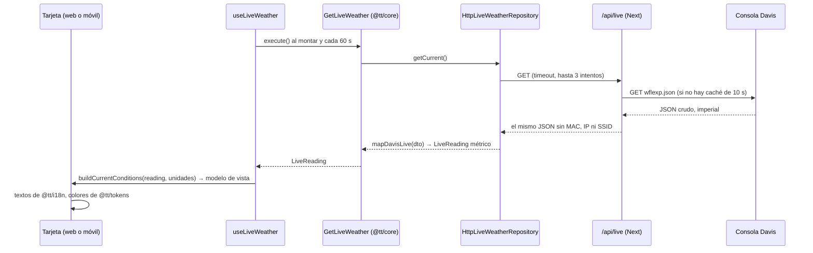
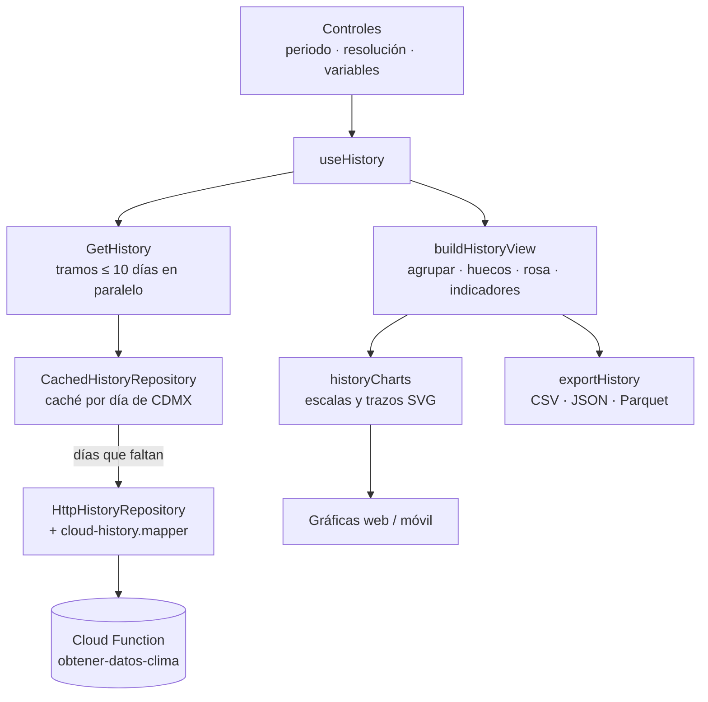

# 12 · Implementación

Este capítulo explica **cómo está construido** el código: qué hay en cada carpeta, cómo viaja un dato desde la
estación hasta la pantalla y por qué las piezas están separadas así. Los capítulos 03 (arquitectura) y 04
(dominio) dicen *qué* forma tiene el sistema; aquí se recorre el código real con los nombres de archivo, para que
alguien que llega nuevo sepa dónde buscar.

## Tecnologías, en una frase cada una

| Tecnología | Dónde | Qué aporta |
|------------|-------|------------|
| **TypeScript** 6 | En todo el repo | JavaScript con tipos: el compilador avisa si una función recibe datos con otra forma |
| **React** 19 | Las dos apps | La UI se escribe como componentes (funciones que reciben datos y devuelven lo que se dibuja) |
| **Next.js** 16 (App Router) | `apps/web` | Framework de React para web: rutas por carpetas, servidor propio (para el proxy `/api/live`) y build de producción |
| **Tailwind CSS** 4 | `apps/web` | Estilos con clases utilitarias (`rounded-md`, `text-wx-temp-text`) que leen los tokens del diseño |
| **Expo** SDK 58 + **React Native** 0.88 | `apps/mobile` | React para Android/iOS: los componentes se convierten en vistas nativas. Expo da las librerías (archivos, compartir, fuentes) y la nube de builds y actualizaciones (EAS) |
| **Expo Router** | `apps/mobile` | Rutas por carpetas, como Next, pero para móvil (`src/app/(tabs)/…`) |
| **react-native-svg** y **reanimated** 4 | `apps/mobile` | Dibujar SVG en móvil y animarlo en el hilo de UI |
| **react-native-android-widget** | `apps/mobile` | Widgets de la pantalla de inicio de Android escritos en React (ADR-0011) |
| **Vitest**, **jest-expo**, **Testing Library**, **MSW**, **axe-core** | Pruebas | Ver [08 · Calidad y pruebas](08-calidad-pruebas.md) |
| **npm workspaces** | Raíz | Un solo `npm install` y un solo `node_modules` para seis proyectos (ADR-0003) |
| **GitHub Actions**, **Cloud Run**, **EAS Update** | CI/CD | Ver [09 · Despliegue](09-despliegue.md) |

## Mapa del repositorio

```
.
├── apps/
│   ├── web/                 Next.js
│   │   ├── app/             rutas: page.tsx (/), historico/, api/live/route.ts, layout.tsx
│   │   ├── components/      now/, history/, shell/, providers/
│   │   ├── hooks/           use-live-weather.ts, use-history.ts
│   │   ├── lib/             core.ts (composition root), live/ (proxy), preferences/, download/, art/
│   │   ├── test/            Vitest + Testing Library + axe
│   │   └── Dockerfile       imagen standalone para Cloud Run (se construye desde la raíz)
│   └── mobile/              Expo
│       ├── index.ts         entrada: registra widgets (solo APK) y arranca Expo Router
│       ├── app.json, eas.json, metro.config.js
│       ├── src/app/         rutas: _layout.tsx, (tabs)/index.tsx (Ahora), (tabs)/historico.tsx
│       ├── src/components/  now/, history/, shell/, ui/, art/svg-art.tsx
│       ├── src/hooks/       los mismos dos hooks que la web
│       ├── src/lib/         core.ts, last-reading.ts, share-file.ts
│       ├── src/widget/      widget de Android
│       └── test/            jest-expo + Testing Library
├── packages/
│   ├── core/      @tt/core      dominio, casos de uso, puertos, adaptadores HTTP, geometría de gráficas
│   ├── i18n/      @tt/i18n      catálogos es/en, formateo en hora de CDMX, textos derivados
│   ├── tokens/    @tt/tokens    paleta clara/oscura, tipografía, hoja de variables CSS, contraste
│   └── sky-art/   @tt/sky-art   SVG de las 21 escenas y de la carga, sus animaciones (CSS y como datos)
├── docs/          esta guía
└── .github/       workflows de CI/CD y la acción release-tag
```

Cada carpeta importante tiene su propio `AGENTS.md` con las reglas locales (está pensado para asistentes de
código, pero se lee igual de bien como guía rápida para personas).

## La idea central: escribir la lógica una vez

Las dos apps muestran lo mismo ("Ahora" e "Histórico") con interfaces distintas. Antes de esta versión cada una
tenía su propia lógica, con errores distintos (ver [00 · Visión](00-vision.md)). Ahora:

- **Todo lo que no es dibujar** vive en `packages/`: convertir unidades, decidir la escena del cielo, agrupar el
  histórico, calcular las escalas de las gráficas, armar los textos, exportar archivos.
- **Cada app solo dibuja** y aporta lo que depende de su plataforma: dónde se guardan las preferencias
  (`localStorage` o AsyncStorage), cómo se descarga un archivo (enlace del navegador u hoja de compartir), cómo se
  anima un SVG (CSS o reanimated).

Por eso, un componente típico de cualquiera de las dos apps se ve así: recibe un **modelo de vista** ya calculado
por `@tt/core`, pide sus textos a `@tt/i18n`, toma sus colores de `@tt/tokens`, y no hace cuentas.

### Arquitectura hexagonal en `@tt/core`

`packages/core/src` está partido en capas. La regla es que las flechas de importación solo apuntan hacia
adentro:

| Carpeta | Qué contiene | Puede importar |
|---------|--------------|----------------|
| `domain/` | Reglas puras: unidades (`units.ts`), viento y Beaufort (`wind.ts`), presión (`pressure.ts`), sensación térmica y punto de rocío (`thermal.ts`), hora de CDMX (`time.ts`), sol (`sun.ts`), pronóstico Davis (`forecast.ts` y las 195 reglas de `forecast-rules.ts`), escena del cielo (`sky-scene.ts`), periodos del histórico | Solo `domain/` |
| `ports.ts` | Interfaces de lo que el núcleo necesita de afuera: `LiveWeatherRepository`, `HistoryRepository`, `PreferencesRepository`, `KeyValueStorage`, `Clock` | `domain/` |
| `application/` | Casos de uso (`GetLiveWeather`, `GetHistory`, `ResolveCurrentSky`, `Get/UpdatePreferences`) y modelos de vista (`buildCurrentConditions`, `buildHistoryView`, `liveStatus`, `exportHistory`, `widgetSummary`) | `domain/`, `ports.ts`, `charts/` |
| `charts/` | Geometría de gráficas sin dibujar nada: escalas "bonitas", trazos SVG (`d="M…"`), medidores, ilustraciones del histórico | `domain/`, modelos de vista |
| `adapters/` | Implementaciones de los puertos con `fetch` estándar: cliente HTTP con reintentos (`http.ts`), consola Davis (`davis-live/`), Cloud Function (`cloud-history/`), caché del histórico, preferencias sobre un almacén clave-valor | Todo lo anterior |
| `container.ts` | `createCore(config)`: arma todo y lo devuelve listo | Todo |
| `index.ts` | La API pública: lo único que importan las apps | Todo |

El núcleo **no importa React, React Native, Next ni Expo**, ni librerías (salvo `hyparquet-writer`, aprobada por
ADR-0012). No es una convención de palabra: `packages/core/test/architecture.test.ts` lee cada archivo y falla si
alguien rompe la regla. Gracias a eso el mismo código corre en el navegador, en el servidor de Next, en Hermes
(el motor de JS de React Native) y dentro del widget de Android.

### Inyección de dependencias

Nada en el núcleo crea por su cuenta sus dependencias. Cada app tiene un *composition root* de pocas líneas:

```ts
// apps/web/lib/core.ts
export function createWebCore(storage: Storage | undefined): Core {
  return createCore({ liveUrl: '/api/live', historyUrl: process.env.NEXT_PUBLIC_API_CLOUD_URL, storage })
}

// apps/mobile/src/lib/core.ts
export function createMobileCore(): Core {
  return createCore({
    liveUrl: process.env.EXPO_PUBLIC_WEATHER_STATION_URL,
    historyUrl: process.env.EXPO_PUBLIC_HISTORY_API_URL,
    storage: AsyncStorage,
  })
}
```

Un *provider* de React (`components/providers/app-providers.tsx` en web, `src/providers/app-providers.tsx` en
móvil) guarda ese objeto y lo entrega con `useCore()`. En las pruebas, `AppProviders` recibe un `core` armado con
repositorios en memoria y un reloj fijo, así que las pantallas se prueban sin red y con resultados
reproducibles.

## Recorrido 1 · El dato en vivo, de la estación a la tarjeta

Este es el camino más importante. Seguirlo con los archivos abiertos es la mejor forma de entender el proyecto.



1. **La consola.** La Davis Vantage Vue publica `wflexp.json` por HTTP en la red del IPN: valores en °F, mph e
   inHg, `---` cuando falta un sensor, y varias rarezas documentadas en [06 · Datos](06-datos.md).
2. **El proxy** (`apps/web/app/api/live/route.ts` → `lib/live/live-proxy.ts`). El navegador no puede llamar a la
   consola (HTTP sin CORS desde una página HTTPS), así que el servidor de Next lo hace por él. Solo consulta la URL
   configurada, guarda la respuesta 10 s para no saturar la consola si hay muchos usuarios, y borra `mac`, `ip`,
   `ssid`. La app móvil usa el mismo proxy (ADR-0007).
3. **El cliente HTTP** (`packages/core/src/adapters/http.ts`). `fetch` con *timeout* y reintentos con espera
   creciente. Los errores salen tipados (`HttpError`), para que la UI distinga "no hay red" de "la consola falló".
4. **El mapper** (`adapters/davis-live/davis-live.mapper.ts`). Es el **único** lugar donde se corrigen las
   rarezas del dato en vivo: convierte a métrico, traduce `---` a `null` (nunca a 0), lee los extremos `hl*` en su
   orden real (D1), interpreta `bartr` como código de tendencia (D4) y corrige la zona horaria de la consola (D12).
   Sale una `LiveReading` (`domain/live-reading.ts`): un objeto limpio, en unidades canónicas, que ya no se
   parece al JSON de Davis.
5. **El caso de uso** `GetLiveWeather` solo pide la lectura al repositorio. Es pequeño a propósito: la lógica está
   en el dominio y la entrada/salida en los adaptadores.
6. **El hook** `useLiveWeather` (`apps/web/hooks/`, `apps/mobile/src/hooks/`). Consulta al montar, cada 60 s y
   cuando el usuario toca "actualizar". Cuenta los segundos desde la última consulta exitosa y le pide a
   `liveStatus` (`application/live-status.ts`) el estado: `loading`, `ok`, `stale` (más de 2 min), `offline` u
   `offlineWithData`. La vigencia se mide con el reloj del dispositivo, no con el de la consola, porque este
   deriva (D12).
7. **El modelo de vista** `buildCurrentConditions` (`application/current-conditions.ts`) hace todas las cuentas
   del panel en las unidades elegidas: sensación térmica y su motivo, barra del rango del día dentro del mes,
   punto de rocío, Beaufort, rumbo, intensidad de lluvia, avance del sol, escena del cielo, pronóstico. No produce
   texto.
8. **Los textos** salen de `@tt/i18n`: el catálogo (`catalogFor('es')`), el formateador de números y fechas en
   hora de CDMX (`createFormatter`) y los *presenters* (`valueText`, `windText`, `rainText`…), que combinan
   número, unidad y redacción igual en las dos apps.
9. **La tarjeta** (`components/now/*-card.tsx`) solo acomoda esos valores según el artboard del diseño.

### La escena del cielo

El héroe de "Ahora" muestra una de 21 ilustraciones animadas (despejado de día, llovizna, tormenta, niebla…).

- **Qué escena:** `resolveSkyScene` (`domain/sky-scene.ts`) evalúa siete capas en orden (sin datos → calibrando →
  pronóstico Davis → lluvia medida → niebla → viento → noche). La tabla completa está en
  [06 · Datos](06-datos.md#escena-del-cielo) y cada regla tiene su caso en `test/domain/sky-scene.test.ts`.
- **El arte:** `@tt/sky-art` no se dibujó a mano. `npm run extract --workspace=@tt/sky-art -- <carpeta>` lee los
  artboards `Sky*.dc.html` del canvas de diseño y genera `scenes.generated.ts` (SVG) y `styles.generated.ts`
  (CSS), con prefijos para que varias escenas convivan sin choques (ADR-0009). Esos archivos no se editan a mano.
- **La animación en web** es el CSS del diseño tal cual. `lib/art/markup.ts` guarda objetos fijos para
  `dangerouslySetInnerHTML`: si se creara uno nuevo en cada render, React reescribiría el SVG y las animaciones
  volverían a empezar cada segundo (ese fue el bug del PR #10).
- **La animación en móvil:** React Native no entiende CSS, así que `motion.ts` describe las mismas animaciones como
  datos (pistas de fotogramas, duración, curva) y `apps/mobile/src/components/art/svg-art.tsx` las reproduce con
  reanimated en el hilo de UI (ADR-0010). `test/motion.test.ts` comprueba que los datos coinciden con las hojas
  CSS. Con "reducir movimiento" activado, en las dos plataformas el arte queda quieto.

## Recorrido 2 · El histórico



1. **El periodo.** El usuario elige 24 h, 7 días, 30 días o "últimos N días". `periodRange`
   (`domain/history-period.ts`) lo traduce a un rango en hora de CDMX que **termina a la medianoche de hoy**,
   porque el pipeline carga los datos con un día de retraso (D7), y que no empieza antes del 19-abr-2026, el
   primer día con datos.
2. **Los tramos.** La Cloud Function corta en 1000 filas (≈ 10 días de lecturas cada 15 min). `GetHistory` parte
   el rango en tramos, los pide en paralelo y une los resultados quitando el duplicado de cada unión (la API
   incluye los dos extremos, D11).
3. **La caché** (`adapters/cached-history.repository.ts`, ADR-0013). Decora al repositorio HTTP: guarda cada día
   en el almacén clave-valor de la app (`wx-history-v1:AAAA-MM-DD`) y solo pide los días que no tiene. Los días que
   ya cerraron no cambian y se guardan sin vencimiento; los recientes vencen a la hora. Si el pipeline corrige
   datos viejos, se cambia el prefijo a `v2` y todas las cachés se invalidan solas.
4. **El mapper** (`adapters/cloud-history/cloud-history.mapper.ts`) corrige las rarezas del histórico: números
   como texto, filas de la más nueva a la más vieja, presión en mmHg con nombre de hPa (D2), fecha y hora por
   separado (D9).
5. **La vista** `buildHistoryView` (`application/history-view.ts`) agrupa las lecturas por la resolución elegida
   (15 min, hora, día, semana lun–dom o mes, en hora de CDMX): promedio y banda mín–máx, lluvia sumada, máximo
   de ráfaga. Un intervalo sin lecturas queda vacío y se dibuja como corte, **nunca como cero** (D8). También
   calcula la rosa de los vientos y los indicadores (máxima, mínima, lluvia total, tendencia de presión).
6. **Las gráficas.** `historyCharts` (`charts/history-charts.ts`) convierte la vista en escalas con marcas
   redondas y en cadenas de trazo SVG (`d="M0,120L10,118…"`) sobre un lienzo de 1000 de ancho. Web y móvil solo
   ponen esas cadenas en un `<path>`; por eso no se usa ninguna librería de gráficas (ADR-0006) y las dos se ven
   igual.
7. **La descarga.** `exportHistory` produce exactamente lo que se ve (resolución y variables visibles) en CSV,
   JSON o Parquet (ADR-0012). La web lo entrega como descarga del navegador (`lib/download/save-file.ts`) y la
   móvil con la hoja de compartir del sistema (`src/lib/share-file.ts`).

## Recorrido 3 · Preferencias, tema, idioma y tamaño de letra

- **El modelo:** `UserPreferences` (`domain/preferences.ts`): `theme` (sistema/claro/oscuro), `language` (es/en),
  `units` (métrico/imperial) y `textSize` (s/m/l). Un valor desconocido cae en el predeterminado, así que una
  clave corrupta no rompe la app.
- **Dónde se guardan:** `KeyValuePreferencesRepository` las escribe en las claves `wx-theme`, `wx-lang`… del
  almacén que le pase la app (`localStorage` o AsyncStorage). Son las mismas claves del diseño.
- **Tema en web:** `@tt/tokens` genera una hoja de variables CSS (`themeStylesheet()`) con la paleta clara en
  `:root` y la oscura en `:root.dark`. Tailwind expone esas variables como clases `bg-wx-*`, `text-wx-*`. Cambiar
  de tema es poner o quitar la clase `dark` en `<html>`; por eso **no se usan variantes `dark:`**. Un script en
  línea del `<head>` (`PREFERENCES_BOOT_SCRIPT` en `lib/preferences/apply.ts`) aplica tema, idioma y tamaño antes
  del primer pintado, para que no parpadee el tema equivocado.
- **Tema en móvil:** no hay CSS; el provider entrega el objeto `palette` del tema activo y cada componente toma
  sus colores de ahí. El texto pasa por el componente `Txt`, que pone la fuente IBM Plex, el color y la escala
  del tamaño elegido.
- **Contraste:** algunos acentos del diseño no llegaban a 4.5:1 como texto en tema claro. `@tt/tokens` agrega
  variantes `*-text` más oscuras para usar en texto, y `test/tokens.test.ts` calcula la razón WCAG de cada par.
- **Idioma:** los catálogos `catalogs/es.ts` y `catalogs/en.ts` son objetos con las mismas claves (el tipo
  `Catalog` sale del español y `test/catalogs.test.ts` verifica la paridad). Algunos textos son funciones
  (`stationName: (name) => …`) para insertar valores.

## Recorrido 4 · El widget de Android

- Existe solo en el APK (ADR-0011): la librería necesita su módulo nativo, que Expo Go no trae. Por eso
  `apps/mobile/index.ts` lo registra solo si `WIDGETS_AVAILABLE` y lo carga con un `require` diferido.
- Android llama a `src/widget/task-handler.ts` al agregar el widget, cada 30 min, al redimensionarlo o al tocar
  ↻. El manejador usa `widget-content.tsx`, que crea **el mismo núcleo** que la app (`createMobileCore`) y arma los
  textos con `buildCurrentConditions` y `widgetText` de `@tt/i18n`.
- Sin red (Android suele despertar el widget en modo Doze, sin conexión), dibuja la última lectura guardada en
  `wx-last-reading` (`src/lib/last-reading.ts`), en gris y con su hora. La app también guarda ahí cada lectura y se
  la pasa al widget, que así no la vuelve a pedir.
- `weather-widget.tsx` lleva `'use no memo'`: el React Compiler transformaba esos componentes y el widget fallaba
  con "Invalid Hook Call".

## Detalles de la plataforma que conviene conocer

- **Next sustituye `process.env.NEXT_PUBLIC_*` al compilar.** Por eso `route.ts` lee cada variable con su nombre
  literal: en Cloud Run esas URLs solo llegan como argumento del build.
- **Metro y `hyparquet-writer`.** Esa librería publica una entrada para Node (que importa `fs`) y otra para
  navegador. `apps/mobile/metro.config.js` hace que Metro use la de navegador solo para ella.
- **El Dockerfile de la web se construye desde la raíz** y copia `packages/`: si se agrega un paquete compartido
  nuevo, también hay que agregar su `package.json` al `Dockerfile`.
- **`/android` y `/ios` no se versionan.** El proyecto nativo se genera en cada build a partir de `app.json`
  (*Continuous Native Generation*). Cualquier ajuste nativo se hace con *config plugins* en `app.json`, no editando
  `/android`.
- **Expo Router 58** cambió la API de `tabBar` (recibe `emitter` y `navigateToTab`). Antes de tocar APIs de Expo,
  consulta la documentación de la versión exacta: <https://docs.expo.dev/versions/v58.0.0/>.
- **Los hooks están copiados** en web y móvil (`useLiveWeather`, `useHistory`), porque son React y los paquetes no
  usan React. Si crecen, la salida es un paquete `@tt/react` con hooks que reciban el núcleo como parámetro.

## Cómo encontrar algo

| Quiero cambiar… | Empieza en |
|-----------------|------------|
| Un cálculo (sensación térmica, Beaufort, tendencia de presión) | `packages/core/src/domain/` y su test en `packages/core/test/domain/` |
| Cómo se interpreta un campo de la consola o del histórico | El mapper en `packages/core/src/adapters/*/` y [06 · Datos](06-datos.md) |
| Qué escena del cielo sale | `packages/core/src/domain/sky-scene.ts` |
| Un texto o su traducción | `packages/i18n/src/catalogs/es.ts` y `en.ts` |
| Cómo se redacta un valor con su unidad | `packages/i18n/src/presenters.ts` |
| Un color | `packages/tokens/src/palette.ts` |
| Cómo se ve una tarjeta | `apps/web/components/now/` o `apps/mobile/src/components/now/` |
| Las gráficas del histórico | `packages/core/src/charts/` (geometría) y `components/history/` de cada app (dibujo) |
| La descarga | `packages/core/src/application/export-history.ts` |
| El proxy | `apps/web/lib/live/live-proxy.ts` |
| El widget | `apps/mobile/src/widget/` |
| CI/CD | `.github/workflows/` y [09 · Despliegue](09-despliegue.md) |
