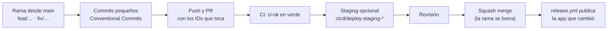

# 13 · Cómo contribuir

Esta guía es para quien quiera corregir un error, agregar una función o continuar el proyecto: estudiantes que
lo retomen como trabajo terminal, servicio social o práctica, y profesores que quieran proponer cambios. No se
necesita permiso para leer ni para experimentar en una copia; para que un cambio llegue a producción hay que
seguir el flujo de abajo.

## Antes de empezar

1. Deja listo el entorno ([11 · Entorno de desarrollo](11-entorno-desarrollo.md)) y comprueba que
   `npm run typecheck` y `npm test` pasan **antes** de tocar nada. Así sabes que lo que falle después es tuyo.
2. Lee lo que vas a tocar: el requerimiento (`RF-APP-NN` en [01 · Requerimientos](01-requerimientos.md)), su caso
   de uso ([02](02-casos-de-uso.md)), y el capítulo de [implementación](12-implementacion.md) de esa parte.
3. Si el cambio es grande o cambia una decisión, revisa los ADR ([adr/](adr/)). Si vas a contradecir uno,
   escribe uno nuevo que lo reemplace (ver abajo).

## El flujo, paso a paso



1. **Rama.** Siempre desde `main` actualizado. Nombres: `feat/…` (función nueva), `fix/…` (error), `refactor/…`,
   `docs/…`. En minúsculas y con guiones: `fix/rain-card-units`.
2. **Commits.** Formato [Conventional Commits](https://gist.github.com/qoomon/5dfcdf8eec66a051ecd85625518cfd13):
   `<tipo>(<alcance>): <descripción>`, en imperativo y minúscula, sin punto final. Título corto y, si hace falta,
   un cuerpo de 1–3 líneas.
   - Tipos: `feat`, `fix`, `refactor`, `perf`, `style`, `test`, `docs`, `build`, `ops`, `chore`.
   - Alcances usados: `core`, `web`, `mobile`, `i18n`, `tokens`, `sky-art`, `ci`.
   - Ejemplos reales del historial: `fix(mobile): reset dashed border on history chips`,
     `docs: record the apk accessibility review with uiautomator`.
   - Un cambio incompatible lleva `!` (`feat(core)!: …`) o un pie `BREAKING CHANGE:`.
3. **Pull request** contra `main`. La descripción dice qué cambia, por qué, qué IDs toca (`RF-APP-07`, `CU-04`,
   `D5`…) y cómo se probó. Si cambia la UI, una captura ayuda.
4. **CI.** `ci.yml` corre solo los jobs de lo que cambió (`packages`, `web`, `mobile`) y los resume en `ci-ok`, el
   único check requerido. Sin `ci-ok` en verde no se puede mergear, ni siquiera siendo administrador.
5. **Staging (opcional).** Un colaborador del repo comenta en el PR exactamente `cicd/deploy-staging-web` o
   `cicd/deploy-staging-app` y el bot responde con la URL o el QR de una vista previa. Se borra al cerrar el PR.
6. **Merge** con *squash*. Al llegar a `main`, `release.yml` publica en producción solo la app afectada (web en
   Cloud Run, móvil por EAS Update) y crea el tag `web-v…` o `mobile-v…`.

> **Sin acceso de escritura** (por ejemplo, si el repo ya pasó a otra cuenta): haz *fork*, trabaja en tu copia y
> abre el PR desde ahí. El CI corre igual; el staging y la publicación los dispara alguien con acceso.

## Lista de revisión de un PR

Quien abre el PR la revisa antes de pedir revisión, y quien revisa la usa como guía:

- [ ] `npm run typecheck` y `npm test` pasan en local.
- [ ] La lógica nueva está en `packages/`, no repetida en las dos apps.
- [ ] `@tt/core` no importa nada de React, Next, Expo ni librerías (`architecture.test.ts` lo vigila).
- [ ] Una rareza de datos se corrige **en el mapper** y tiene su test con el ID `Dn` de [06 · Datos](06-datos.md).
- [ ] "Sin dato" sigue siendo `null`, no 0.
- [ ] Los textos nuevos están en `es.ts` **y** en `en.ts`.
- [ ] Los colores salen de `@tt/tokens`; para texto de color, las variantes `*-text`.
- [ ] Cada control nuevo tiene rol, nombre accesible y área táctil de al menos 44 dp (móvil).
- [ ] Los tests nuevos tienen cabecera (qué regla, de dónde sale, qué RF) y `describe`/`it` en español.
- [ ] Si el cambio contradice algo de `docs/`, `docs/` se actualiza en el mismo PR.
- [ ] No se commitean `.env`, `*.apk`, tokens ni archivos de `proj-files` (`terraform.tfvars`, `*.tfstate`).

## Convenciones de código

- **Nombres que expliquen la intención**, en inglés en el código (`resolveSkyScene`, `isPlausibleSeaLevelPressure`);
  comentarios, documentación y tests en español.
- **Funciones cortas y puras** donde se pueda: entrada → salida, sin leer el reloj ni la red por su cuenta (el reloj
  se inyecta con `Clock`).
- **Constantes con nombre** para los umbrales (`DRIZZLE_MAX_MM_H = 0.5`, `STALE_AFTER_MS`), exportadas para que el
  test las use.
- **Cada archivo empieza con un comentario** que dice qué es y de dónde salen sus reglas (requerimiento, nota del
  diseño, rareza de datos).
- **Sin código muerto** ni bloques comentados: el historial de git ya los guarda.
- **Tipos estrictos.** `readonly` en los modelos, uniones de literales (`'metric' | 'imperial'`) en vez de strings
  libres, y nada de `any`.
- **Estilos en web:** utilidades `bg-wx-*`/`text-wx-*`, sin variantes `dark:`; cifras con la clase `num`.
- **Estilos en móvil:** colores de `palette`, texto con `Txt`, sin `fontWeight` (cada peso es otra familia).
- Formato: el repo no tiene ESLint ni Prettier. Sigue el estilo del archivo que editas (dos espacios, comillas
  simples, sin punto y coma, líneas de hasta ~120 caracteres).

## Cómo escribir pruebas

Toda regla nueva lleva su prueba en el mismo PR. La guía completa está en
[08 · Calidad y pruebas](08-calidad-pruebas.md); en corto:

```ts
/**
 * Viento — escala de Beaufort a partir de km/h.
 * Fuente: tabla de la OMM; docs/06-datos.md#interpretación-de-variables.
 * Requerimientos: RF-APP-01, RF-APP-04.
 */
describe('beaufortFromKmh', () => {
  it.each([
    { caso: 'calma', kmh: 0.5, fuerza: 0 },
    { caso: 'límite inferior de Beaufort 4', kmh: 20, fuerza: 4 },
  ])('$caso: $kmh km/h es fuerza $fuerza', ({ kmh, fuerza }) => {
    expect(beaufortFromKmh(kmh)).toBe(fuerza)
  })
})
```

- **Dónde:** el test vive en la carpeta `test/` del paquete o app, con la misma ruta que el archivo que prueba
  (`src/domain/wind.ts` → `test/domain/wind.test.ts`).
- **Datos reales:** para mappers, usa los fixtures de `packages/core/test/fixtures/` (con su README). Si una
  fuente cambia de forma, captura un fixture nuevo con fecha y conserva el anterior.
- **Pantallas:** monta la pantalla con `AppProviders` y un `core` armado con dobles (repositorios en memoria, reloj
  fijo). Busca por texto o rol accesible, como lo haría una persona (`getByRole('button', { name: 'Actualizar' })`).
- **Cobertura:** `@tt/core` exige al menos 80 % de líneas; el CI falla por debajo.
- **Trazabilidad:** si el test cubre un RF nuevo, agrégalo a la matriz de [08](08-calidad-pruebas.md#matriz-de-trazabilidad).

## Recetas

### Agregar o cambiar un texto

1. Agrega la clave en `packages/i18n/src/catalogs/es.ts` (el tipo `Catalog` sale de este archivo).
2. Agrega la misma clave en `en.ts`; TypeScript marca el error si falta, y `catalogs.test.ts` también.
3. Úsala en el componente con `t.seccion.clave` (el catálogo llega por `usePreferences()`).

### Mostrar un dato nuevo de la consola

Supón que quieres mostrar la radiación solar, si la consola la publicara.

1. **Datos.** Documenta el campo en `apps/web/docs/realtime-data-schema.md` y en [06 · Datos](06-datos.md), con su
   unidad y sus rarezas.
2. **DTO.** Agrega el campo a `adapters/davis-live/davis-live.dto.ts` (tal como llega: `string | null`).
3. **Dominio.** Agrega la propiedad, ya en unidades canónicas, a `LiveReading` (`domain/live-reading.ts`).
4. **Mapper.** Conviértelo en `davis-live.mapper.ts` con `parseNumber` (que ya traduce `---` a `null`), y pruébalo
   con un fixture real en `test/adapters/davis-live.mapper.test.ts`.
5. **Modelo de vista.** Si hay cálculo o conversión de unidades, va en `buildCurrentConditions`, con su test.
6. **Textos** en `@tt/i18n` (catálogos y, si combina número y unidad, un *presenter*).
7. **UI.** Una tarjeta en `apps/web/components/now/` y otra en `apps/mobile/src/components/now/`, cada una según su
   artboard. Prueba de pantalla en cada app.
8. **Serialización.** Si el widget debe ver el dato sin red, revisa `adapters/live-reading-json.ts`.
9. **Docs.** Requerimiento o criterio en [01](01-requerimientos.md) si hace falta, y la fila de la matriz en [08](08-calidad-pruebas.md).

### Corregir una rareza nueva de los datos

1. Reprodúcela con un dato real y guárdalo como fixture (anonimizado: sin MAC, IP ni SSID).
2. Dale el siguiente ID (`D14`…) en la tabla de [06 · Datos](06-datos.md#rarezas-y-dónde-se-corrigen): qué pasa,
   cómo se corrige y cómo se confirmó.
3. Corrígela **solo** en el mapper correspondiente, con un test que cite el ID.
4. Si cambia datos del histórico que ya están en caché, sube el prefijo `HISTORY_CACHE_PREFIX` a la siguiente
   versión (`wx-history-v2:`), como dice ADR-0013.
5. Si el error está en el pipeline (fuera de este repo), anótalo como pendiente en lugar de parcharlo en la app.

### Agregar o cambiar una escena del cielo

1. La regla va en `domain/sky-scene.ts` (y el ID nuevo en `SKY_SCENES`), con su caso en `test/domain/sky-scene.test.ts`.
2. El arte se dibuja en el canvas de diseño (artboard `Sky<Nombre>`) y se extrae con
   `npm run extract --workspace=@tt/sky-art -- <carpeta con los Sky*.dc.html>`. No edites `*.generated.ts` a mano.
3. Si trae animaciones nuevas, agrégalas como datos en `packages/sky-art/src/motion.ts`; `motion.test.ts` revisa
   que coincidan con el CSS.
4. Nombre de la escena en `es.ts` y `en.ts`, y actualiza la tabla de [06 · Datos](06-datos.md#escena-del-cielo).

### Agregar una dependencia

- **En `@tt/core`, casi nunca.** Solo librerías de JS puro sin APIs de plataforma, con un ADR que lo justifique y
  agregándola a la lista de `test/architecture.test.ts` (así entró `hyparquet-writer`, ADR-0012).
- **En la app móvil**, instala con `npx expo install <paquete>` desde `apps/mobile` para que Expo elija la versión
  compatible con el SDK. Si el paquete tiene código nativo, solo funcionará en un APK nuevo, no por EAS Update.
- **Herramientas de prueba** (vitest, vite, msw) van en el `package.json` de la raíz, no en el paquete: npm no
  resuelve bien el *hoisting* de vite si quedan dentro.
- Después de instalar, confirma que `package-lock.json` cambió y súbelo en el mismo commit.

### Registrar una decisión (ADR)

Cuando una decisión afecta la arquitectura o es difícil de revertir (una librería nueva, otro hosting, cambiar
cómo se guarda algo), escribe `docs/adr/NNNN-titulo-corto.md` con el siguiente número y estas secciones:

```markdown
# ADR-0014 · Título en forma de decisión

- **Estado:** Aceptada (AAAA-MM-DD)

## Contexto
Qué problema había, qué restricciones aplicaban y qué alternativas se consideraron.

## Decisión
Qué se eligió, en concreto (archivos, librerías, reglas).

## Consecuencias
Qué se gana, qué se pierde y qué hay que vigilar.
```

Agrégalo a la tabla de [adr/README.md](adr/README.md). Un ADR no se borra: si la decisión cambia, el nuevo dice a
cuál reemplaza y el viejo se marca **Reemplazada por ADR-NNNN**.

### Actualizar la documentación y el PDF

- La documentación es parte del cambio: si el código contradice `docs/`, se corrige `docs/` en el mismo PR.
- Los IDs (`RF-APP-NN`, `CU-NN`, `Dn`, ADR) nunca se reutilizan; lo retirado se marca **Retirado**.
- Los diagramas se escriben en Mermaid dentro del Markdown (GitHub los dibuja).
- El PDF de esta guía se regenera con `docs/pdf/build.sh` (ver [README del PDF](pdf/README.md)).
